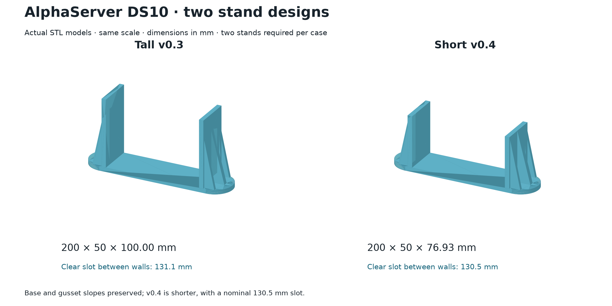
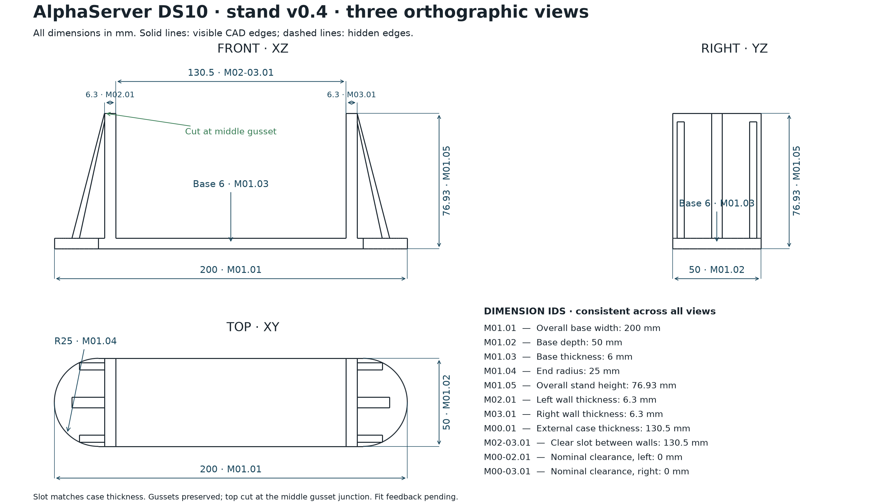

# AlphaServer DS10 vertical stands

A pair of identical one-piece stands for an AlphaServer DS10 case measured at **130.5 mm** thick. This repository contains the **tall v0.3** and **short v0.4** designs. All dimensions are in millimeters; all models use **1:1 scale**.

| Dimensions / printing a pair | [Tall v0.3](variants/v03-high/README.md) | [Short v0.4](variants/v04-low/README.md) |
|---|---:|---:|
| One stand, X × Y × Z | 200 × 50 × 100 mm | 200 × 50 × 76.93 mm |
| Clear slot between retaining walls | 131.1 mm | 130.5 mm |
| Total nominal clearance around the case | 0.6 mm | 0 mm |
| Retaining wall thickness | 6 mm | 6.3 mm |
| Base thickness | 6 mm | 6 mm |
| Slicer time estimate, two stands | 4 h 34 min 56 s | 4 h 9 min 20 s |
| Estimated PLA for two stands | 193.82 g | 173.54 g |

In v0.4, the top is trimmed at the junction between the middle gusset and the outer retaining wall. The base, outer wall faces, and gusset slopes are preserved from v0.3. Adding 0.3 mm to the inner face of each wall reduces the slot to 130.5 mm. The tall version retains its original printed geometry and 131.1 mm slot.

Both pairs were printed successfully on a QIDI Q2, as confirmed by the printer's job history. The v0.3 design received positive feedback, followed by a request to reduce the slot width. Fit feedback for v0.4 is still pending. No physical strength testing has been performed.

## Files

Each variant has its own directory containing:

- `models/`: a STEP file, a single-stand STL, and geometry-only 3MF files for one stand and a pair.
- `drawings/`: three dimensioned orthographic views with persistent dimension IDs, in PNG and SVG.
- `printing/`: a ready-to-print `.gcode.3mf` package, the same G-code as a separate file, and print settings and profiles.
- `source/` and `data/`: a parametric CadQuery model, drawing source, dependencies, parameters, and dimension definitions.

The `.3mf` files in `models/` contain geometry. The `.gcode.3mf` packages in `printing/` contain sliced jobs for **two stands**, using a **QIDI Q2, 0.4 mm nozzle, and PLA**. For another printer, slice the STEP, STL, or geometry-only 3MF with the appropriate machine profile.

Print settings: **0.28 mm** layers, **4 wall loops**, **25% gyroid**, up to **16 mm³/s** volumetric flow, **230 °C** nozzle, and **55 °C** bed. The flat base rests on the bed. Both stands are parallel, with no rotation or X offset and a **5 mm** gap along Y. The test printer used spool **1B**, mapped to logical tool **T0**; select the spool mapping on your printer.

[Printing instructions and recorded times](docs/PRINTING.md) · [Source and verification](docs/BUILD.md) · [Dimensions and design background](docs/DESIGN.md).

## Drawings

### Tall v0.3

[Scalable SVG](variants/v03-high/drawings/three_projections.svg)

### Short v0.4

[Scalable SVG](variants/v04-low/drawings/three_projections.svg)

Geometry and print-package checks are recorded in [VALIDATION.json](VALIDATION.json). See [MANIFEST.json](MANIFEST.json) for package contents and [SHA256SUMS.txt](SHA256SUMS.txt) for checksums.
