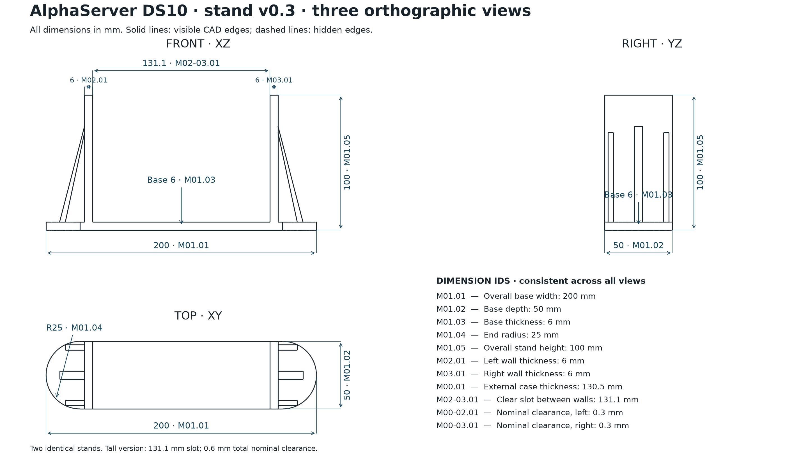

# AlphaServer DS10 tall stand - v0.3

Use **two identical stands** for one case. One stand measures **200 × 50 × 100.00 mm**. Clear slot: **131.1 mm**; retaining walls: **6.0 mm**; base thickness: **6 mm**. All models use millimeter units and 1:1 scale.

[Scalable SVG](drawings/three_projections.svg)

## Models

- [Single-stand STEP](models/ds10_stand_v03.step).
- [Single-stand STL](models/ds10_stand_v03.stl).
- [Single-stand geometry 3MF](models/ds10_stand_v03.3mf).
- [Two-stand geometry 3MF](models/ds10_two_stands_v03.3mf).

## Printing

[Ready-to-print pair](printing/ds10_v03_two_stands_QIDI_Q2_PLA.gcode.3mf) · [G-code](printing/ds10_v03_two_stands_QIDI_Q2_PLA.gcode) · [Settings and checksums](printing/print_settings.json).

QIDI Q2, 0.4 mm nozzle, PLA, 230/55 °C, 0.28 mm layers, 4 wall loops, 25% gyroid, 16 mm³/s flow. Slicer estimate for a pair: **4h 34m 56s / 193.82 g**. The package contains both stands and is unchanged from the completed print. Select the physical filament slot on your printer; the test print used spool 1B.

[Printing instructions](../../docs/PRINTING.md), [design dimensions](../../docs/DESIGN.md), [source and rebuilding](../../docs/BUILD.md).

Original tall design with 0.6 mm total nominal clearance for a 130.5 mm case.
